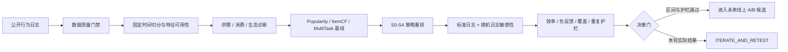

# FlowLens｜内容分发策略与实验决策工作台

> 一套可复现的内容分发策略研究项目：用公开短视频行为日志完成数据质量门禁、供需诊断、排序基线、策略重排、多目标评估和实验决策。

**当前状态：Gate 2–Gate 4 均已通过独立校验；Gate 5B 项目作品集完成；RankLab Gate A–C 已跑通，Gate D 本地完整复现与发布检查通过，验证决策为 ITERATE_AND_RETEST。代码采用 Apache-2.0，提交后仍需在干净 clone 中复核。**

[查看网页版项目介绍](https://athenazhang-junzi.github.io/FlowLens/) · [查看 PDF 项目介绍](./output/pdf/FlowLens-推荐分发项目介绍.pdf) · [查看完整证据索引](./04-证据索引与声明边界.md) · [查看 RankLab 集成设计](./docs/integration/README.md)

## 30 秒看懂这个项目

FlowLens 回答的不是“哪个模型分数最高”，而是内容分发系统中一个更完整的策略问题：

> 在有效消费、负反馈、内容覆盖和重复体验相互制约时，如何从日志定位问题、提出策略、控制数据泄漏，并决定上线、重测还是停止？

项目基于 [KuaiRand-Pure](https://zenodo.org/records/10439422) 公开数据，按固定时间窗完成了五类策略的离线回放。最终没有把正向点估计包装成成功：S2 多样性策略改善作者／标签重复，但 NDCG@5 与 Top-5 ECR 的配对置信区间均跨 0，因此决策为 **ITERATE_AND_RETEST**。

| 证据层 | 已完成 | 可核验结果 |
|---|---|---|
| 数据可靠性 | 数据许可、粒度、重复、标签、关联与时间泄漏审计 | Great Expectations 129 条阻断规则全部通过 |
| 问题诊断 | 供需错配、消费效率、重复体验与曝光集中度 | 形成标签 39、2、12 等待验证假设，不虚构标签语义 |
| 推荐基线 | Popularity、ItemCF、MultiTaskHashSGD 统一时间切分 | 标准曝光与随机曝光日志出现模型排序反转 |
| 分发策略 | 协同融合、多样性、长尾探索、负反馈与疲劳控制 | S0–S4 均有不可变参数快照与解释样本 |
| 决策闭环 | 配对 Bootstrap、多目标护栏、冻结测试与 A/B 方案 | S1–S4 全部重测，没有伪造上线收益 |

## 核心结果

### Gate 3：先证明“离线最好”并不稳定

| 日志口径 | Popularity NDCG@5 | ItemCF NDCG@5 | MultiTaskHashSGD NDCG@5 | 排名第一 |
|---|---:|---:|---:|---|
| 标准曝光测试集 | 0.5869 | 0.5983 | **0.6236** | MultiTaskHashSGD |
| 随机曝光敏感性集 | 0.2993 | **0.3247** | 0.2303 | ItemCF |

模型排序反转说明离线结果明显受日志采集策略与原推荐策略影响。因此项目只把这些结果用于 **logged-exposure reranking** 和稳健性诊断，不解释为线上因果增量。

### Gate 4：让策略决策服从证据门槛

标准曝光测试集上，S2 相对冻结基线 S0：

| 指标 | S0 | S2 | 变化／区间 | 决策含义 |
|---|---:|---:|---:|---|
| NDCG@5 | 0.623576 | 0.624075 | +0.000499，95% CI [-0.000324, 0.001235] | 区间跨 0 |
| Top-5 ECR | 45.93% | 45.99% | +0.06pp，95% CI [-0.02pp, 0.14pp] | 区间跨 0 |
| 作者重复@10 | 0.36% | 0.31% | 下降约 0.05pp | 体验护栏改善 |
| 标签重复@10 | 31.39% | 29.74% | 下降约 1.65pp | 多样性改善 |
| 内容覆盖@10 | 88.49% | 87.54% | 下降约 0.95pp | 需要继续权衡 |

所以 S2 是下一轮优先迭代对象，而不是“胜出策略”或上线候选。完整判定见 [Gate 4 策略与决策备忘录](./reports/gate4/Gate4-策略与决策备忘录.md)。

## 决策链路



## 项目能力地图

| 核心能力 | FlowLens 证据 |
|---|---|
| 策略设计与供需匹配 | 标签供需／消费缺口诊断，S1–S4 配置化策略 |
| 全链路数据洞察 | 数据门禁 → 特征 → 排序 → 护栏 → 决策的完整血缘 |
| 实验驱动决策 | 验证集选参、冻结测试、配对区间、A/A／SRM／停止规则设计 |
| 多目标拆解 | 有效消费为主指标，覆盖、重复、负反馈和集中度为护栏 |
| 推荐系统基础认知 | 协同过滤、多任务学习、重排、多样性和选择偏差边界 |

## 快速查看

不下载数据也可以直接查看已经执行并保存输出的报告：

- [Gate 2 数据质量报告](./reports/data-quality/Gate2-数据质量报告.md)／[Notebook HTML](./reports/data-quality/Gate2-notebook.html)
- [Gate 3 诊断与基线报告](./reports/gate3/Gate3-诊断与基线报告.md)／[Notebook HTML](./reports/gate3/Gate3-notebook.html)
- [Gate 4 策略与决策备忘录](./reports/gate4/Gate4-策略与决策备忘录.md)／[Notebook HTML](./reports/gate4/Gate4-notebook.html)
- [Gate 4 线上 A/B 实验设计](./reports/gate4/Gate4-线上AB实验设计.md)
- [RankLab Gate C 统一离线评估](./reports/integration/GateC-统一离线评估.md)
- [RankLab Gate D 复现与发布说明](./docs/integration/04-reproduction-and-release.md)
- [打开主仓库内的 LiveLab](./apps/livelab/index.html)

## 本地复现

### 1. 准备环境与数据

```bash
python -m venv .venv --system-site-packages
.venv/bin/python -m pip install -r requirements-gate2.txt
.venv/bin/python -m pip install -r requirements-gate3.txt
.venv/bin/python -m pip install -r requirements-gate4.txt
```

按照 [data/README.md](./data/README.md) 下载并校验 KuaiRand-Pure。原始、解压及清洗数据不会进入 Git。

### 2. Gate 2：数据质量

```bash
.venv/bin/python scripts/audit_kuairand_pure.py
.venv/bin/python scripts/prepare_kuairand_event_views.py
.venv/bin/python scripts/validate_kuairand_with_gx.py
.venv/bin/python scripts/build_gate2_notebook.py
```

### 3. Gate 3：诊断与基线

```bash
.venv/bin/python scripts/run_gate3.py
.venv/bin/python scripts/validate_gate3_outputs.py
.venv/bin/python scripts/build_gate3_notebook.py
```

当前有效运行：`gate3-3b42b7057a17`，独立校验 13/13 通过。

### 4. Gate 4：策略与决策

```bash
.venv/bin/python scripts/run_gate4.py
.venv/bin/python scripts/validate_gate4_outputs.py
.venv/bin/python scripts/build_gate4_notebook.py
```

当前有效运行：`gate4-c2f35eb1de6d`，独立校验 15/15 通过。

### 5. RankLab 检查与复现

```bash
make ranklab-check
make ranklab-smoke
# 完整 10,000 训练组 / 2,000 验证请求：
make ranklab-gatec
```

运行前需完成公开数据准备和 Gate 3 候选生成；详见 [Gate D 复现与发布说明](./docs/integration/04-reproduction-and-release.md)。

## 目录结构

```text
FlowLens/
├── apps/livelab/  # 固定种子模拟 + Gate C E3 离线摘要
├── config/       # 数据契约、特征注册和冻结策略配置
├── data/         # 下载说明；真实数据被 .gitignore 排除
├── notebooks/    # 已执行的 Gate 2–4 分析 Notebook
├── docs/         # GitHub Pages 项目介绍
├── portfolio/    # 网页源文件与可复用图表
├── output/pdf/   # 10 页 PDF 项目介绍
├── reports/      # 可直接审阅的报告、指标与运行清单
├── scripts/      # 审计、训练、评估、校验和报告生成脚本
├── 02-指标与实验口径.md
└── 04-证据索引与声明边界.md
```

## 证据边界

- 项目是使用公开数据完成的个人作品，不代表任何真实平台的内部系统。
- E3 离线回放只能支持策略比较与实验假设，不能证明线上因果收益。
- 评估候选来自已记录曝光，不是全量内容库召回。
- 数字标签没有公开业务名称，只按 ID 描述。
- 收入指标保持 N/A；没有虚构商业收益、真实线上 A/B 或组织影响。
- Evidently／MLflow 使用字段兼容的本地 JSON 适配层，不声称原生服务集成。

完整 Claim→证据→允许表述见 [证据索引与声明边界](./04-证据索引与声明边界.md)。

## 数据与许可

KuaiRand-Pure 数据由原发布方以 CC BY-SA 4.0 提供，本仓库不重新分发数据。数据来源、校验值及下载方法见 [data/README.md](./data/README.md)。

本项目代码采用 [Apache License 2.0](./LICENSE)。KuaiRand-Pure 数据不随仓库重新分发，其 CC BY-SA 4.0 许可与归属保持独立；Metarank 仍是通过官方 Apache-2.0 镜像接入的外部依赖。

## 下一步

当前已按 [FlowLens RankLab 集成计划](./docs/integration/README.md) 完成事件导出、契约校验、Metarank 运行时、统一验证集评估、LiveLab 主仓库集成和一键复现。Gate C 使用 10,000 个训练回放组和 2,000 个验证请求；Metarank 的 NDCG@5 与 ECR@5 均明确低于冻结基线。下一步是在提交后用干净 clone 复核发布检查，并在验证集上修正特征设计。

当前证据反而表明 Metarank 本轮验证表现不及现有基线，因此未查看冻结测试集，也不声称已有效果提升。Apache-2.0 只解决代码使用与再分发授权，不改变数据许可、第三方归属或实验结论边界。
