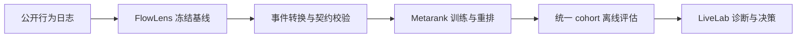

# FlowLens RankLab

一个面向内容推荐策略的离线验证工作台：用 FlowLens 提供冻结基线与评估口径，用 Metarank 完成可复现重排，再把结果送入 LiveLab 做指标诊断和策略决策。

> 这是基于 KuaiRand-Pure 公开数据完成的个人研究项目，不是线上推荐系统，也不代表任何平台的真实业务实验。

## 这个项目解决什么问题

推荐策略不能只看一个模型分数。FlowLens RankLab 把一次策略验证拆成三层：

1. **离线基线**：固定数据切分、候选集、指标和护栏，避免比较口径漂移。
2. **重排运行时**：将日志转换为 Metarank 事件，训练 LambdaMART，并校验排序前后的候选守恒。
3. **决策界面**：LiveLab 同时展示真实离线结果和固定种子的实验诊断原型，帮助判断继续、暂停或重新迭代。



## 当前验证结论

Gate C 使用 10,000 个训练回放组和 2,000 个验证请求。Metarank 相对冻结基线的结果如下：

| 指标 | 冻结基线 | Metarank | 差异 |
|---|---:|---:|---:|
| NDCG@5 | 0.754306 | 0.704503 | -0.049803 |
| Top-5 ECR | 49.2829% | 47.7572% | -1.5258pp |
| 内容覆盖@10 | 92.5484% | 93.1446% | +0.5961pp |
| 标签重复@10 | 21.8339% | 21.6208% | -0.2131pp |

覆盖和标签重复有所改善，但主效率指标下降，因此当前决策是 **`ITERATE_AND_RETEST`**，没有解锁冻结测试集，也不声称取得线上收益。

完整结果见 [Gate C 统一离线评估](./reports/integration/GateC-统一离线评估.md)。

## 快速体验

### 1. 打开 LiveLab

```bash
make livelab
```

浏览器访问 `http://127.0.0.1:4187`。这一部分不需要 npm、Docker 或数据库。

### 2. 运行仓库检查

```bash
python3.12 -m venv .venv
.venv/bin/python -m pip install -r requirements-integration.txt
make ranklab-check
```

检查内容包括集成测试、运行时锁、离线产物血缘、公开发布安全检查和 LiveLab 静态测试。

### 3. 复现 Metarank 链路

准备 KuaiRand-Pure 数据与 FlowLens 候选文件并启动 Docker 后：

```bash
make ranklab-smoke   # 小样本端到端验证
make ranklab-gatec   # 完整 Gate C 规模复现
```

数据准备、固定版本和产物说明见 [复现指南](./docs/integration/04-reproduction-and-release.md)。

## 仓库结构

```text
FlowLens-RankLab/
├── apps/livelab/          # 可直接运行的实验诊断界面
├── config/                # 冻结基线、策略与事件契约
├── docs/integration/      # 架构、契约、边界和复现说明
├── reports/integration/   # 最小公开结果与可追溯清单
├── scripts/               # Metarank 适配、评估与校验脚本
├── services/metarank/     # 固定镜像和 LambdaMART 配置
├── tests/                 # 合同与集成测试
└── Makefile               # 检查、演示和复现入口
```

旧版 Gate 2–4 Notebook、重复网页/PDF、内部设计过程稿和大体积逐用户中间结果已从公开仓库移除。仓库只保留理解、运行和核验当前 RankLab 所需的内容。

## 证据边界

- 数据来自公开的 [KuaiRand-Pure](https://zenodo.org/records/10439422)，原始数据不随仓库分发。
- 当前结果属于 logged-exposure 离线回放，不是线上 A/B 或因果增量。
- LiveLab 的实验队列是固定随机种子的本地模拟；顶部 RankLab 卡片才读取真实公开数据的离线摘要。
- Metarank 是固定版本的外部依赖，本仓库不复制其 Scala 源码。
- 项目代码采用 [Apache License 2.0](./LICENSE)；数据和第三方组件仍遵循各自许可证。

## 延伸阅读

- [集成架构](./docs/integration/01-system-architecture.md)
- [事件契约](./docs/integration/02-event-contract.md)
- [证据与声明边界](./docs/integration/03-evidence-boundary.md)
- [Metarank 运行说明](./services/metarank/README.md)
