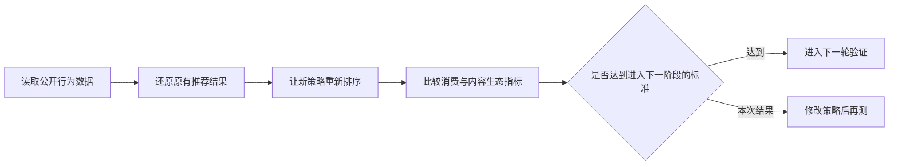

# FlowLens RankLab

这是一个推荐策略验证项目。

它研究的问题很具体：如果一套新策略让推荐内容更丰富，却让用户更不愿意看，这套策略还要不要继续？

我用公开的短视频行为数据做了一次完整演练。项目会比较原有排序和新排序的表现，检查消费效率、内容丰富度、重复体验和负反馈，最后给出明确的产品决策。

> 当前结论：新策略改善了一部分内容生态指标，但核心消费指标下降，因此不进入下一阶段，继续修改后再测。

## 30 秒看懂这个项目

推荐策略经常会遇到这样的取舍：

- 让更多内容获得曝光，用户看到的内容会更丰富；
- 但推荐结果变得更分散，也可能让用户更难看到真正感兴趣的内容；
- 如果只挑上涨的指标汇报，很容易把一次失败的实验包装成成功。

FlowLens RankLab 做的事情，就是把这些冲突放进同一张判断表里。



## 我做了什么

这是一个个人项目。我主要完成了以下工作：

1. 把模糊的“推荐效果更好”拆成可以判断的产品问题。
2. 设计主指标和保护指标，避免只看单一数据下结论。
3. 接入开源排序工具 Metarank，让新旧排序使用同一批用户和内容进行比较。
4. 设置数据检查和决策门槛。结果不达标时，不查看后续测试数据，也不把局部上涨解释成整体成功。
5. 制作 LiveLab，把实验状态、指标口径和决策理由放到一个可交互页面里。

## 这次结果说明了什么

本次验证使用 2,000 个推荐请求，共比较 10,889 个候选内容。结果不是简单的“新策略更好”或“更差”，而是出现了明显取舍。

| 产品问题 | 原有排序 | 新排序 | 怎么理解 |
|---|---:|---:|---|
| 用户能否更快看到合适的内容 | 0.7543 | 0.7045 | 排序质量下降 |
| 前 5 条内容的有效消费率 | 49.28% | 47.76% | 下降 1.53 个百分点 |
| 有多少不同内容获得了推荐机会 | 92.55% | 93.14% | 内容覆盖略有提升 |
| 前 10 条中相同标签的重复程度 | 21.83% | 21.62% | 重复略有减少 |

新策略确实让内容更丰富了一点，但代价是用户消费效率明显下降。覆盖和重复的改善幅度不足以抵消核心指标损失。

所以本次决策是 `ITERATE_AND_RETEST`，也就是修改策略后重新验证，而不是进入上线测试。

[查看完整离线评估结果](./reports/integration/GateC-统一离线评估.md)

## 产品经理可以重点看什么

这个项目不是为了证明某个模型有多先进，而是展示一次推荐策略如何做决策：

- 如何把业务目标拆成主指标和保护指标；
- 如何处理消费效率与内容生态之间的冲突；
- 如何提前约定成功标准，避免看到结果后临时修改口径；
- 如何在结果不理想时，给出“继续、停止还是修改”的明确判断；
- 如何区分离线结果、模拟实验和真实线上收益。

## 打开 LiveLab

LiveLab 是这个项目的交互演示页面。它可以查看离线结果，也可以体验实验健康检查、指标口径下钻和决策记录。

```bash
make livelab
```

然后打开 `http://127.0.0.1:4187`。

页面本身不需要安装前端依赖，也不需要启动 Docker。

## 项目的真实性边界

- 项目使用 [KuaiRand-Pure](https://zenodo.org/records/10439422) 公开数据，不包含任何公司的内部数据。
- 当前结论来自离线回放，不是真实线上 A/B 实验，也不能证明业务收益。
- LiveLab 顶部的 RankLab 卡片来自真实运行的离线结果，实验队列部分是固定随机种子的本地模拟。
- Metarank 是外部开源工具，本仓库只保留接入配置和验证代码，没有复制它的源代码。

## 如果你想看实现细节

仓库保留了复现和检查当前结果所需的代码。运行完整链路需要 Python、Docker，以及提前准备好的 KuaiRand-Pure 数据。

```bash
python3.12 -m venv .venv
.venv/bin/python -m pip install -r requirements-integration.txt
make ranklab-check
make ranklab-smoke
```

- [系统如何连接](./docs/integration/01-system-architecture.md)
- [数据如何传递](./docs/integration/02-event-contract.md)
- [哪些结论可以说，哪些不能说](./docs/integration/03-evidence-boundary.md)
- [完整复现说明](./docs/integration/04-reproduction-and-release.md)
- [Metarank 运行说明](./services/metarank/README.md)

本项目代码采用 [Apache License 2.0](./LICENSE)。公开数据和第三方工具继续遵循各自的许可证。
