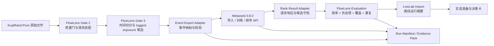

# FlowLens RankLab｜系统架构 v1

## 1. 架构原则

1. **职责分离**：诊断和业务决策留在 FlowLens，学习排序留在 Metarank。
2. **候选守恒**：重排只能改变显式候选的顺序，不能把未观测内容解释为已召回候选。
3. **时间优先**：训练特征和反馈必须早于评估请求，不能因适配器转换引入未来信息。
4. **产物优先**：组件间通过版本化文件和 API 合同连接，每一步都能单独检查。
5. **外部依赖隔离**：Metarank 以固定镜像运行；上游故障不污染 FlowLens 的历史有效结果。

## 2. 逻辑架构



图中的 Metarank 和 LiveLab 接口均已在 Gate B／C 落地。LiveLab 通过生成的静态摘要连接，不需要在浏览器中直接调用 Metarank。

## 3. 物理目录落地

```text
FlowLens/
├── scripts/
│   ├── export_metarank_events.py    # 训练事件导出
│   ├── call_metarank_rank.py        # 排序请求与候选守恒
│   ├── hydrate_metarank_items.py    # 验证候选元数据补齐
│   ├── evaluate_metarank_gatec.py   # 统一 cohort 评估
│   └── build_gatec_livelab_payload.py
├── services/
│   └── metarank/
│       ├── config.yml
│       ├── compose.yml
│       └── THIRD_PARTY.md
├── config/
│   └── integration/                 # 事件合同与配置快照
├── docs/
│   └── integration/                 # 产品、架构与证据边界
├── runs/                            # 本地运行；大产物默认不进入 Git
│   └── <integration_run_id>/
├── reports/
│   └── integration/                 # 小型、可审阅的摘要与校验结果
└── tests/                            # 事件、排序、元数据与评估测试

apps/
└── livelab/                          # 主仓库内的静态伴生前端
    └── data/ranklab_offline_run.js   # Gate C 生成的只读摘要
```

Gate B／C 没有重构既有 Gate 2–4 目录，也没有复制 Metarank 源码。适配器留在 `scripts/`；Gate D 将 LiveLab 纳入主仓库，但仍通过可追溯静态产物与评估层解耦。

## 4. 两条运行链

### 4.1 训练链

```text
训练窗清洗事件
→ 按 user + date + tab 构造 E3 回放排序组
→ 发出 item / ranking / interaction 事件
→ 合同校验
→ Metarank 导入与训练
→ 保存模型信息、日志和 manifest
```

回放排序组不是原始平台请求。KuaiRand-Pure 没有可验证的完整 request/slate ID，因此适配器只能把同一用户、日期和场景下的历史曝光构造成离线训练组，并标记 `source_mode=logged_exposure_replay`。

### 4.2 评估链

```text
Gate 3 验证／测试候选
→ 保留候选 ID 与上游分数
→ 调用 /rank/<model>?explain=true
→ 校验输入输出候选集合一致
→ 输出 metarank_score / metarank_rank / features
→ FlowLens 使用原标签计算统一指标与护栏
```

随机曝光集只用于采集策略敏感性检查，不能混入标准测试结论。

## 5. 数据接口

| 接口 | 输入 | 输出 | 责任方 |
|---|---|---|---|
| Gate 2 → Event Adapter | 清洗事件、内容元数据、质量报告 | 通过／阻断状态 | FlowLens |
| Gate 3 → Rank Adapter | candidate scores、split manifest、run manifest | 排序请求 JSONL | FlowLens Adapter |
| Adapter → Metarank | `item`、`ranking`、`interaction` JSONL | 接收计数、训练数据、模型 | Metarank |
| FlowLens → `/rank` | 显式候选及上游分数 | 有序内容、模型分数、解释特征 | Metarank |
| Rank Adapter → Gate C | 请求、响应、错误、候选守恒结果 | 评估输入表 | FlowLens Adapter |
| Evaluation → LiveLab | 只读运行摘要 JSON | 页面上的离线运行卡 | Gate C Adapter |

详细字段见 [事件契约](./02-event-contract.md)。

## 6. 运行血缘

每次集成运行生成 `integration_run_id`，建议格式为：

```text
ranklab-<UTC YYYYMMDDTHHMMSSZ>-<config sha256 前 8 位>
```

manifest 至少记录：

- FlowLens Git commit；
- 上游 Gate 2／3 run ID；
- 数据文件哈希或公开数据归档 MD5；
- 事件契约版本；
- 适配器脚本哈希；
- Metarank 镜像 tag 与 digest；
- Metarank 配置哈希与模型名；
- 随机种子；
- 请求数、候选数、交互数、错误数；
- 校验状态与产物相对路径；
- 证据等级和声明边界。

## 7. 失败隔离与阻断策略

| 故障 | 处理 |
|---|---|
| Gate 2 阻断规则失败 | 不导出事件 |
| ID 重复或父排序缺失 | 标记运行 INVALID，不训练 |
| 时间倒序或未来特征 | 标记运行 INVALID，不评估 |
| Metarank 导入／训练失败 | 保存日志和失败 manifest，不生成效果结论 |
| 排序响应缺项、增项或重复项 | 阻断该请求；整体运行不得标记 VALID |
| 部分 API 超时 | 保存请求级错误；默认不使用不完整样本比较模型 |
| 指标区间跨 0 或护栏失败 | 输出 `ITERATE_AND_RETEST`，不输出“提升” |
| LiveLab 导入非 VALID 运行 | 只显示不可决策状态 |

## 8. 依赖与许可证边界

- Metarank：外部 Apache-2.0 依赖，以官方 Docker 镜像运行；第三方声明需保留项目名、版本、来源和许可证。
- `metarank-zh`：非官方中文翻译仓库，作为文档参考链接，不复制进 FlowLens。
- KuaiRand-Pure：数据许可为 CC BY-SA 4.0；FlowLens 不重新分发原始数据。
- FlowLens／LiveLab：主仓库代码采用 Apache License 2.0；数据集与外部依赖继续遵循各自许可证和归属声明。
